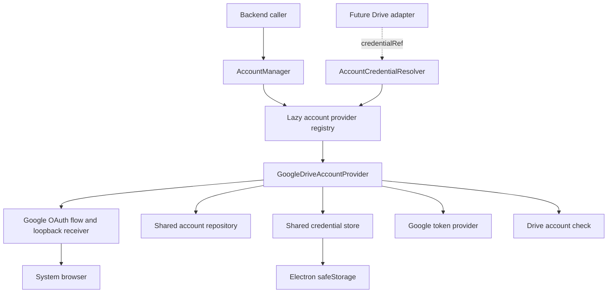

# Google Drive Account Integration

Design · November 4, 2026 · Backend implementation added November 5, 2026

For configuration, backend entry points, and opt-in smoke commands, see [Google Drive account development](google-drive-development.md).

Google Drive implements the shared [account provider contract](account-management.md). The [lazy service lifecycle](lazy-service-initialization.md) defers both shared account infrastructure and individual providers. Startup opens neither; listing saved account metadata opens only the shared store.

## Scope and Decisions

Deliver backend account onboarding and lifecycle management: browser authorization, multiple accounts, encrypted credential persistence, restart recovery, token refresh, reauthorization, local removal, and a minimal Drive API check.

The project supplies a Desktop OAuth client; development can override its configuration. Request full Drive read/write authorization. Frontend screens, new preload/IPC methods, Drive file operations, space discovery, upload drivers, and production upload-checkpoint persistence remain separate work. This phase does not register a partial `StorageAdapter` or imply that files can already be browsed.

## Components and Dependencies



Use Google's [`google-auth-library`](https://github.com/googleapis/google-cloud-node-core/tree/main/packages/google-auth-library-nodejs) for OAuth code exchange, ID-token verification, and refresh. Its SDK types stay inside the Google integration. The shared account infrastructure supplies `electron-store`, Zod validation, and Electron's async `safeStorage` encryption. Dependency versions are locked through npm; the full `googleapis` package is unnecessary for this phase.

The account service, browser launcher, callback receiver, token provider, encryption, persistence, and HTTP transport have injectable boundaries for tests. The existing provider-neutral storage contracts require no changes.

## OAuth Client and Permissions

Release builds receive the project-owned Desktop client configuration through release configuration. Development overrides are read only by the main process. Keep development and release account stores separate. Record the client ID with each grant; changing the configured client must not silently replace an existing grant's identity.

Request `openid`, `email`, and `https://www.googleapis.com/auth/drive`. Identity scopes support account binding and display. Display names can come from the Drive account check, so `profile` is unnecessary. Record the scopes actually granted and require the Drive scope before accepting a new account. Full Drive authorization is restricted; `drive.file` does not cover a general file manager. See [Drive scopes](https://developers.google.com/workspace/drive/api/guides/api-specific-auth).

Use a public Desktop client without a hosted OAuth intermediary. An optional Desktop client secret supplied by configuration is not a security boundary; the application cannot keep an embedded secret confidential. Keep real client configuration and all user credentials out of the repository.

## Authorization Flow

1. Allow one interactive authorization attempt at a time, while existing accounts remain usable. Give the attempt a five-minute deadline and an `AbortSignal`; a second attempt returns a busy error.
2. Start a listener bound to `127.0.0.1` on an OS-assigned port before opening the browser. Generate fresh PKCE S256 material, `state`, and an OIDC `nonce` for this attempt.
3. Open the generated Google authorization URL with `shell.openExternal`. Request offline access and explicit account selection. Request consent when obtaining a persistent grant or replacing an unusable one; ordinary token refresh does not open the browser.
4. Accept only the expected callback host, path, method, and unambiguous parameters. Verify `state` before consuming the code, reject replay, and enforce single completion. Unrelated or invalid requests must not consume the legitimate attempt.
5. Exchange the code using its verifier and exact redirect URI. Verify the ID token's signature, issuer, audience, expiry, and expected nonce. Verify the granted scopes and account binding before committing any credentials.
6. Require a refresh token for a new persistent grant. If Google omits it, reuse a stored token only for the same verified subject and client; otherwise finish with a recoverable authorization error.
7. Perform the minimal Drive check, encrypt the credential payload, and atomically save the account. Report success only after persistence completes.

Close the listener and release attempt state on success, cancellation, timeout, browser-launch failure, or shutdown. Cancellation after code exchange must still prevent a late result from saving an account. Callback responses use fixed, self-contained English text with `no-store`; they never include codes, tokens, or provider error bodies. See [Desktop OAuth](https://developers.google.com/identity/protocols/oauth2/native-app).

## Account Identity and Connection Binding

Use the verified Google `sub` as the remote identity; email and display name are mutable labels. Deduplicate by provider, subject, and OAuth client ID. Authorizing an existing identity updates the existing account instead of allocating a second connection. Reauthorization of a selected account must return its original subject and client; choosing another account returns an identity-mismatch error and preserves the original record. See [Google identity claims](https://developers.google.com/identity/openid-connect/openid-connect).

Allocate a random connection ID and credential reference once. Persist this future connection definition with the account:

```ts
const connection: ConnectionDefinition = {
  id: connectionId,
  provider: 'google-drive',
  configuration: { subject: googleSubject, oauthClientId },
  credentialRef,
};
```

Keep email, display name, scopes, timestamps, and tokens outside `configuration`. Refresh and same-account reauthorization retain the definition and its fingerprint. Removed IDs are never reused; adding the account again creates a new connection, so old references and checkpoints cannot silently attach to a replacement. My Drive and Shared Drives will become spaces of this connection when a Drive adapter is implemented; they are not separate login identities.

Implement the existing `CredentialResolver` port by returning a backend-only Google authorization handle with `getAccessToken(ctx)`. It is bound to the subject, client, and credential reference. A future adapter validates that binding against its connection definition. The handle exposes its own access token, never the repository or refresh token.

## Persistence and Encryption

Use the shared `accounts.json` snapshot under the application's `userData` directory. The common record stores the provider-scoped identity key, immutable connection configuration, optional display labels, timestamps, revision, and ciphertext. Google's actual granted scopes live in versioned `providerData`; `GoogleAccountRepository` validates and projects this private schema. The shared encrypted envelope binds Google's refresh-token payload to its account and connection; the Google credential codec additionally validates subject/client fields. Access tokens, ID tokens, authorization codes, PKCE verifiers, and pending login attempts stay in memory.

Use `safeStorage.isAsyncEncryptionAvailable`, `encryptStringAsync`, and `decryptStringAsync` after Electron is ready. Do not fall back to plaintext when encryption is unavailable. Handle temporary key unavailability separately from invalid grants, and re-encrypt through the repository when key rotation requires it. Decryption failure leaves the account visible with an actionable credential-unavailable status. Windows encryption is tied to OS credentials; copying application files does not promise portable authorization. See [Electron safeStorage](https://www.electronjs.org/docs/latest/api/safe-storage).

The repository owns all snapshot writes and serializes read-modify-write operations. Save metadata and ciphertext in a single atomic replacement using `electron-store`; do not split an account update across independent keys or files. The host acquires a single-instance lock for the account-store namespace before opening it. Validate the version and records on load; do not clear an unreadable or unsupported store automatically. An I/O failure must not be reported as a successful add, refresh-token replacement, or removal.

## Refresh, Recovery, and Removal

Restore account summaries on the first explicit metadata listing without loading Google authentication code, opening browsers, or probing accounts. Authorization starts unchecked; the next explicit check or backend token request refreshes lazily. Keep authorization state separate from the latest connectivity result: a network outage is not proof of revoked authorization, and a saved grant is not proof of current connectivity.

Cache access tokens with their expiry and a small refresh margin. Concurrent requests for one credential share a refresh; different accounts refresh independently. Canceling one waiter does not cancel work still needed by another. Preserve the previous refresh token when a response omits a replacement, and await persistence before accepting any replacement token. SDK token events alone are insufficient to guarantee that a save has completed.

Treat `invalid_grant` as requiring reauthorization. Network, rate-limit, API-disabled, and Workspace-policy errors retain their distinct meaning. Never start interactive login from `CredentialResolver`. Reauthorization failure preserves the previous record; success replaces its credentials and invalidates its token cache.

Removal blocks new credential resolution, cancels the account's pending work, evicts cached tokens, and atomically deletes its record. A per-account generation check prevents late refresh or authorization results from restoring removed or superseded credentials. Runtime disposal closes listeners and clears caches while retaining saved accounts.

Removal is local to this installation. Programmatic grant revocation is outside this phase: Google revocation can invalidate the same user's grants across clients in the project, so it must be an explicit, separately designed action. See [Google token revocation](https://developers.google.com/identity/protocols/oauth2/web-server#tokenrevoke).

## Minimal Drive Check and Backend API

Call `GET https://www.googleapis.com/drive/v3/about?fields=user(displayName,emailAddress)` with the account's access token in the Authorization header. Validate the selected response fields and return a timestamped check result with optional display metadata. An API check proves this request succeeded; it does not prove write permission to every file or access to every Shared Drive. See [`about.get`](https://developers.google.com/workspace/drive/api/reference/rest/v3/about/get).

Initial add and reauthorization require a successful check before saving their candidate grant. A failed add leaves no account; a failed reauthorization preserves the old one. Existing accounts remain saved when a later check fails. OAuth and API requests use the same explicitly configured backend transport, with cancellation and timeouts. Browser connectivity is independent of backend connectivity. Retry only bounded, safe operations; do not blindly replay a possibly consumed authorization code or future file writes through SDK automatic request replay.

Backend callers use the common manager; Google authentication is selected by provider and method:

```ts
const runtime = await services.accounts.get(context.signal);
const saved = await runtime.accounts.list('google-drive');
const account = await runtime.accounts.add('google-drive', { method: 'browser' }, context);
await runtime.accounts.updateAuthentication(account.id, { method: 'browser' }, context);
await runtime.accounts.verify(account.id, context);
await runtime.accounts.remove(account.id, context);
```

Summaries contain the connection ID, provider ID, optional display labels, authorization/credential status, and last check. They exclude private provider data, scopes, credential references, tokens, SDK objects, raw OAuth responses, and callback URLs. Distinguish cancellation, timeout, identity mismatch, insufficient scope, invalid client configuration, credential-store failure, and provider/network failures using safe account-domain errors. Translate authorization failures to existing storage errors at the resolver boundary. Logs contain safe operation names and categories; SDK errors and HTTP headers/bodies must not be logged wholesale.

## Implementation Order and Acceptance

| Step | Deliverable                                                           | Required evidence                                                                                                  |
| ---- | --------------------------------------------------------------------- | ------------------------------------------------------------------------------------------------------------------ |
| 1    | Account models, repository, encryption binding, single-writer startup | Atomic updates, restart restoration, encryption/decryption failure, corrupt/versioned data handling                |
| 2    | OAuth client configuration, callback receiver, browser flow           | PKCE/state/nonce validation, wrong host/path, replay, denial, cancellation, timeout, shutdown cleanup              |
| 3    | Identity binding, token provider, credential resolver                 | Multiple accounts, duplicate login, wrong-account reauthorization, isolated refresh, replacement-token persistence |
| 4    | Drive check and account service lifecycle                             | Partial consent, missing refresh token, invalid grants, API/network failures, removal versus late results          |
| 5    | Main-process wiring and developer setup notes                         | Existing checks pass; an opt-in live smoke check exercises login, restart, refresh, reauthorization, and removal   |

Unit and integration tests use fake browser, OAuth, clock, encryption, transport, and repository boundaries; a loopback integration test uses only the local machine. Default tests require no real Google credentials or external service. The opt-in Electron smoke harness verifies OS-backed encryption and encrypted persistence with synthetic data; live commands exercise real Google accounts in a separate profile. A real-account check of a packaged release remains part of release validation and requires the project's OAuth client and interactive consent.

Before live testing, enable Drive API, configure the consent screen, and supply a Desktop client with allowed test users. External OAuth projects in Testing can issue Drive refresh tokens that expire after seven days; recovery must handle this as reauthorization, not promise permanent login. See [refresh-token expiration](https://developers.google.com/identity/protocols/oauth2#expiration). Public distribution requires evaluating restricted-scope verification and its applicable exceptions; this local design does not assume a hosted token service or server-side storage. See [Google verification guidance](https://developers.google.com/identity/protocols/oauth2/production-readiness/restricted-scope-verification).
