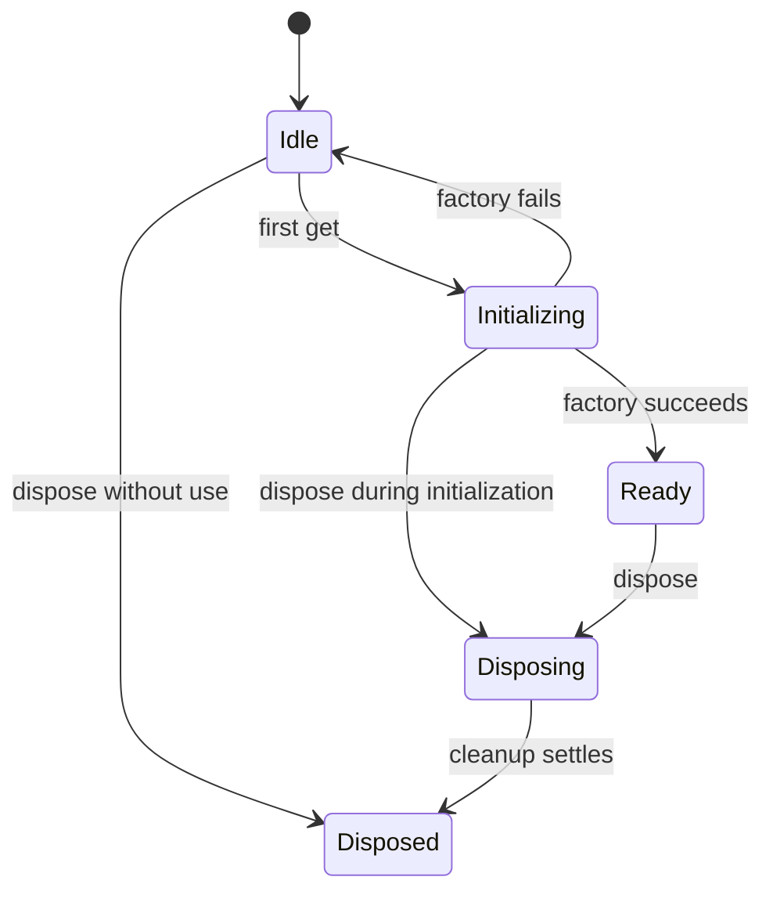

# Lazy Service Initialization

The application opens its window without constructing account infrastructure. The first explicit account request opens one shared runtime. Individual account providers initialize only when authentication, verification, or credential resolution needs them. Listing saved metadata never loads provider SDKs or reads their client configuration.

## Ownership and Access

`ApplicationServices` owns `accounts: LazyService<AccountRuntime>`. Its constructor declares a factory and disposer without invoking them. The main process retains profile selection and its single-instance lock at startup. Consumers share the runtime and let the application dispose it.

```ts
const runtime = await services.accounts.get(context.signal);
const saved = await runtime.accounts.list();
const descriptors = runtime.accounts.listProviders();

// This operation additionally initializes the Google account provider.
await runtime.accounts.add('google-drive', { method: 'browser' }, context);
```

The account runtime owns an `AccountProviderRegistry`. Registration consists of static metadata and a deferred factory. Each provider has its own `LazyService<AccountProvider>`, so an initialization failure or active operation on one platform does not serialize other platforms. An unavailable provider's saved metadata remains readable and its local record remains removable.

## Module Boundaries

The host waits for Electron readiness, checks its lifetime signal, dynamically imports `accounts/runtime/desktop-accounts.ts`, checks again, and constructs shared persistence, encryption, and provider registrations. This keeps `electron-store` and account validation code out of the executed startup graph.

Google registration imports only its SDK-free descriptor. Its factory dynamically imports `providers/google-drive/desktop-provider.ts`, checks the owner signal, and constructs Google's SDK, client configuration, browser, and callback bindings. The production build preserves separate main-process chunks for the common runtime and deferred Google provider. Erased type imports do not cross either runtime boundary.

Initialization does not authenticate or probe saved accounts automatically. Browsers, callback listeners, credential decryption, refresh, and API requests stay tied to explicit operations. The [account architecture](account-management.md) describes how metadata, provider state, and credential routing fit together.

## Lifecycle Rules



- Concurrent first callers share one initialization promise and one instance. Later business operations run independently.
- An already-aborted caller starts no initialization. Canceling one waiter rejects only its wait, leaving the shared attempt available to others.
- A failed attempt returns the slot to Idle. A later explicit request can retry; there are no background retries and no automatic data clearing.
- A factory cleans up resources it allocated before rejecting. The holder cannot dispose an instance that was never returned.
- Successful instances remain owned until shutdown. There is no idle eviction or per-operation reconstruction.
- Shutdown without use never invokes the factory or imports its module.
- Shutdown during initialization aborts the owner signal, rejects new gets, and waits for the attempt. A late result is disposed exactly once and never returned to callers.
- Repeated disposal shares one promise. The slot remains closed even if cleanup fails; cleanup never calls `get()`.

Factories receive an owner signal rather than the first caller's signal. Check that signal around imports and resource construction. Cancellation of a request is separate from application shutdown.

## Disposal and Verification

Application disposal closes the account slot. Account-runtime disposal aborts active operations, disposes initialized providers, and flushes shared repository writes. Cleanup collects independent failures so one failing disposer does not skip another. The main process records safe categories and completes its quit flow.

`services/lazy-service.test.ts` covers concurrency, independent waiter cancellation, failed-attempt retries, disposal without initialization, shutdown races, exactly-once cleanup, and permanent closure after failure. `services/application-services.test.ts` and `main/index.test.ts` reject accidental eager runtime imports. Common account tests cover provider initialization isolation and removal during module loading.

The opt-in Electron harness verifies the same boundaries: `idle` constructs and disposes the owner without touching a corrupt account store; `list` reads the common store even with invalid Google client configuration; `infrastructure` checks actual OS encryption and restart persistence using synthetic records. See [development commands](google-drive-development.md). Real Google login requires separate interactive validation with configured client credentials.
