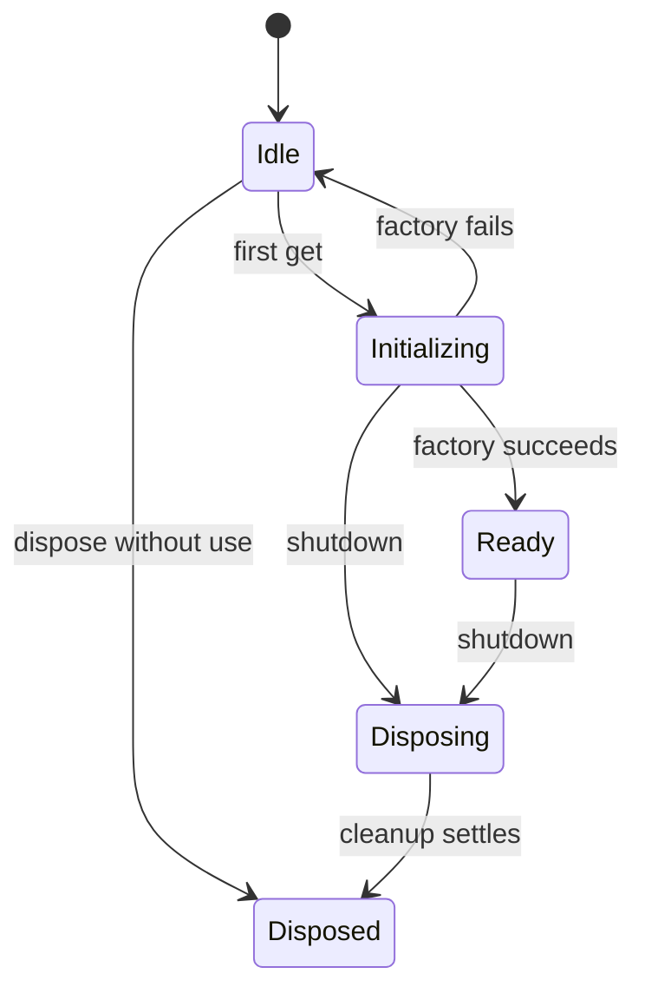

# Lazy Service Initialization

Lazy initialization gives application services a shared owner while keeping integrations tied to demand. Constructing the [application-service host](../src/main/services/application-services.ts) registers factories and disposers without invoking them. UI requests, including initial workspace loading, can be the first consumers of a service.

The [lazy holder](../src/main/services/lazy-service.ts) defines access and disposal behavior. Consumers share the owner's instance and leave disposal to the owner.

## Initialization Boundaries

Account access has two boundaries: opening the shared runtime and initializing an individual provider. Listing metadata can open common persistence, but must not load provider SDKs, read provider client configuration, decrypt credentials, or contact providers. Provider authentication, verification, and credential use cross the additional provider boundary.

Register providers using SDK-free descriptors and deferred factories. Each provider has its own holder, so one provider's initialization failure or active work does not serialize other providers. An unavailable provider must not block metadata listing or local removal of its saved account. Provider registration and common runtime composition are owned by the [account runtime](../src/main/accounts/runtime/).

Keep deferred integrations out of the executed host-construction graph. Factories wait for Electron readiness where required and check their owner signal around imports and resource construction. Service creation itself must not launch interactive authentication or probe saved accounts.

## Lifecycle Rules

- Concurrent first callers share one initialization attempt and instance. Business operations after initialization remain independent.
- An already-cancelled caller starts no initialization. Cancelling one waiter rejects only its wait; it does not cancel work needed by others.
- Failed initialization permits a later explicit retry without background retries or automatic data clearing.
- Factories use the owner's lifetime signal and clean up resources allocated before a failed construction. The holder can dispose only an instance actually returned to it.
- A successful instance remains owned until shutdown. Closing a dialog or completing an operation does not dispose it.
- Disposal without use does not invoke the factory. Disposal during initialization closes access immediately, aborts the owner signal, and waits for construction. A late instance is disposed exactly once and never delivered to a caller.
- Repeated disposal shares one promise. Access remains closed even when cleanup fails; cleanup must not call `get()`.

## Shutdown

The application closes its service holders and attempts independent cleanup even if one disposer fails. Account disposal cancels active work, disposes initialized providers, and flushes pending repository writes. Saved accounts survive shutdown.

The [account architecture](account-management.md) owns account-specific removal and persistence rules. See the [development guide](google-drive-development.md#smoke-checks) for isolated lifecycle and encryption smoke commands.
