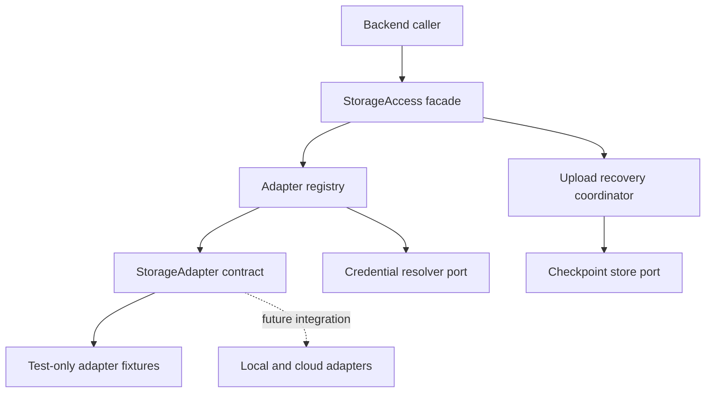

# Storage Access Abstraction

Design and infrastructure implementation notes · November 1, 2026

## Current Delivery Scope

This phase covers provider-neutral infrastructure only: contracts, adapter registration and dispatch, capability handling, normalized errors, stream lifecycle, and upload recovery coordination through injected ports.

Local disks, Google Drive, and S3 are future consumers of these contracts. Their differences guide the design and contract tests; implementing any real storage adapter is outside this phase. No provider SDK, OAuth flow, network client, volume enumerator, product UI, or new IPC endpoint is required now.

## Confirmed Decisions

| Topic                        | Decision                                                                                                        |
| ---------------------------- | --------------------------------------------------------------------------------------------------------------- |
| Future compatibility targets | Local disks, Google Drive, AWS S3 and S3-compatible services                                                    |
| Adapter strategy             | Define first-party TypeScript adapter contracts now; integrate native APIs and provider clients in later phases |
| Scope                        | Storage access contracts; transfer scheduling and synchronization are separate layers                           |
| Resource addressing          | Preserve native IDs, keys, and paths                                                                            |
| Local access                 | Enumerate volumes and access any directory permitted by the OS; allow saved roots                               |
| Google Drive                 | My Drive and Shared Drives; document export and conversion are application concerns                             |
| S3 configuration             | Custom endpoint, region, credentials, and addressing style                                                      |
| Data access                  | Streaming, cancellation, byte ranges, and capability-aware resumable uploads                                    |
| Recovery                     | Upload sessions must survive application restarts and reconcile with backend state                              |

## Architecture



Keep contracts independent of Electron and provider SDK types. Modules can be hosted in the main process and later reused in a utility process or CLI. This phase defines the backend API without connecting it to the renderer.

The access layer owns individual storage operations and upload recovery. Future transfer and sync services own cross-connection orchestration, recursive traversal, queues, schedules, conflict policies, and comparison rules. Native-document export, sharing, previews, and content encryption belong above this boundary.

## Resource Model

- **Provider**: a registered adapter type identified by an extensible key. Future examples include `local`, `google-drive`, and `s3`; do not hardcode these as the only supported types.
- **Connection**: a configured account or endpoint, with an application-generated ID and credential reference.
- **Space**: an addressable storage root: a volume, My Drive, a Shared Drive, or a bucket. Space discovery can be permission-limited; explicitly configured roots/buckets remain usable without global enumeration rights.
- **EntryRef**: connection ID, space ID, and an opaque adapter-owned locator. It identifies a location using native semantics; it is not a universal immutable identity.
- **Entry**: common metadata, optional revision/checksums, and effective operation capabilities. Missing metadata means unknown, not zero or false.

```ts
interface EntryRef {
  connectionId: string;
  spaceId: string;
  locator: string;
}

interface Entry {
  ref: EntryRef;
  name: string;
  kind: 'file' | 'directory' | 'link' | 'other';
  size?: number;
  modifiedAt?: string;
  revision?: string;
  checksums?: Array<{ algorithm: string; value: string }>;
  capabilities: EntryCapabilities;
}
```

Use nonnegative safe integers for byte counts, ISO timestamps, and opaque revision tokens. Keep revision tokens separate from content checksums.

Paths support navigation; names and display paths are not keys. Google Drive permits duplicate names within a folder, so name lookup returns candidates rather than silently selecting one. S3 keys retain their exact case and separators; inferred prefixes are distinct from objects. Only the local adapter applies OS path rules. See [Drive file metadata](https://developers.google.com/workspace/drive/api/reference/rest/v3/files) and [S3 object keys](https://docs.aws.amazon.com/AmazonS3/latest/userguide/object-keys.html).

Moves return the resulting entry/reference. A path or key reference can become invalid after a rename; adapters must not fabricate permanent IDs. Links are represented explicitly and are not followed automatically during traversal.

## Access Contract

The following sketch describes the facade. Supporting request types carry explicit targets, options, and cancellation. The facade validates context and routes calls to registered adapters; it does not implement storage protocols.

```ts
interface StorageAccess {
  listSpaces(connectionId: string, ctx: OperationContext): Promise<Space[]>;
  stat(ref: EntryRef, ctx: OperationContext): Promise<Entry>;
  list(parent: EntryRef, request: ListRequest, ctx: OperationContext): Promise<EntryPage>;
  read(ref: EntryRef, options: ReadOptions, ctx: OperationContext): Promise<ReadHandle>;
  write(target: WriteTarget, source: ByteSource, ctx: OperationContext): Promise<Entry>;
  createDirectory(target: CreateTarget, ctx: OperationContext): Promise<Entry>;
  remove(ref: EntryRef, ctx: OperationContext): Promise<void>;
  copyWithin(ref: EntryRef, target: CreateTarget, ctx: OperationContext): Promise<Entry>;
  moveWithin(ref: EntryRef, target: CreateTarget, ctx: OperationContext): Promise<Entry>;
  capabilities(scope: CapabilityScope, ctx: OperationContext): Promise<Capabilities>;
  uploads: ResumableUploads;
}

interface ResumableUploads {
  create(target: WriteTarget, source: SourceDescriptor, ctx: OperationContext): Promise<UploadId>;
  inspect(id: UploadId, ctx: OperationContext): Promise<UploadStatus>;
  resume(id: UploadId, source: ReopenableByteSource, ctx: OperationContext): Promise<Entry>;
  discard(id: UploadId, ctx: OperationContext): Promise<DiscardResult>;
}
```

Contract rules:

- `OperationContext` carries `AbortSignal`, correlation ID, and optional byte-progress callbacks.
- `list` returns one page and an opaque cursor. Cursors are bound to the connection, parent, and request. Enumeration is not a transaction or a globally sorted snapshot.
- `read` returns a backend-only Node.js readable stream, optional length/revision, and disposal. Ranges use `{ offset, length? }`; adapters translate native range conventions. Cancellation remains active for the stream lifetime. Unsupported ranges fail explicitly. Conditional reads accept an expected revision only when the adapter can enforce it. Consumers must dispose abandoned streams.
- `ByteSource` opens a stream with backpressure. Its reopenable variant supplies known length, source descriptor, and range reopening for retries/recovery. A one-shot stream supports ordinary writes but cannot promise restart recovery. Validate this contract with synthetic streams; a filesystem-backed source is a future integration.
- `WriteTarget` distinguishes creation under a parent from replacement of an exact reference. The caller explicitly selects create-only, unconditional replacement, or conditional replacement. Create-only never overwrites an existing resource; Drive may create another ID with the same name.
- Conditional replacement must use a supported backend guarantee, including at publication after a resumed upload. An adapter must not substitute a racy read-then-write check. AWS exposes conditional writes, while compatible endpoints require individual support checks. See [S3 PutObject](https://docs.aws.amazon.com/AmazonS3/latest/API/API_PutObject.html).
- `remove` deletes one file/link or an empty directory. Recursive deletion and cross-connection copy/move require higher-level orchestration.
- `copyWithin` and `moveWithin` expose supported native operations within a connection. Unsupported or cross-filesystem operations fail explicitly; no hidden copy-then-delete fallback.

## Capabilities and Future Compatibility Checks

Capabilities describe support (`supported`, `unsupported`, or `unknown`), scope, and guarantees such as conditional replacement or durable recovery. Effective support depends on the adapter, endpoint, space, entry type, and permissions. Capability metadata is advisory; operations still enforce authorization and normalize failures.

The following are design constraints for future adapters, not implementation tasks for this phase.

| Future consumer       | Constraint on the common infrastructure                                                                                                                                |
| --------------------- | ---------------------------------------------------------------------------------------------------------------------------------------------------------------------- |
| Local storage         | Allow native paths, multiple volumes, links, and filesystem-specific move restrictions. Root discovery and actual filesystem access belong to a later adapter.         |
| Google Drive          | Allow opaque IDs, duplicate names, multiple drive spaces, and per-entry permissions. The model must not require every entry to expose a byte stream.                   |
| S3-compatible storage | Preserve exact keys, distinguish prefixes from objects, accept connection-specific configuration, and make native rename and conditional writes optional capabilities. |

For background, see [Node filesystem behavior](https://nodejs.org/docs/latest-v24.x/api/fs.html), [Shared Drive semantics](https://developers.google.com/workspace/drive/api/guides/enable-shareddrives), and [custom endpoint configuration](https://github.com/aws/aws-sdk-js-v3/blob/main/supplemental-docs/CLIENTS.md). SDK selection and configuration mapping are deferred to the corresponding integration phase.

Do not infer a universal content hash from an ETag. Preserve algorithm and checksum semantics separately, and expose unknown capability rather than assuming every S3-compatible endpoint implements AWS features. See [S3 ETag semantics](https://docs.aws.amazon.com/AmazonS3/latest/API/API_Object.html) and [integrity checks](https://docs.aws.amazon.com/AmazonS3/latest/userguide/checking-object-integrity.html).

## Durable Upload Recovery

Implement the generic session lifecycle, versioned checkpoint envelope, store port, and adapter recovery hooks. Future adapters own their transport protocols and validate their private checkpoint payloads. Do not require every backend to use one global chunk size, a contiguous offset, or the same commit semantics.

`UploadStatus` distinguishes created, active, suspended, completed, expired, discarded, and unknown outcomes. Progress separates bytes processed from bytes durably acknowledged; only acknowledged state can become a recovery checkpoint.

The following examples constrain the recovery extension; their concrete drivers are deferred.

| Future backend | Private recovery state                                                                    | Required extension behavior                                                                                      |
| -------------- | ----------------------------------------------------------------------------------------- | ---------------------------------------------------------------------------------------------------------------- |
| Local          | Temporary-file identity/path, confirmed byte position, destination, and source descriptor | Verify the temporary file and confirmed prefix before appending; publish according to the explicit write policy. |
| Google Drive   | Session URI, target identity, source descriptor, and confirmed progress                   | Query server status and continue from the acknowledged byte position. Treat expired sessions as `ResumeExpired`. |
| S3             | Upload ID, object target, part layout, completed-part receipts, and source descriptor     | Query uploaded parts and reconcile receipts before uploading missing parts and completing the object.            |

Drive uses resumable sessions with provider-defined chunk alignment and expiration. S3 multipart uploads retain independently uploaded parts until completed or aborted, subject to endpoint lifecycle policies. Their recovery drivers must remain distinct. See [Drive uploads](https://developers.google.com/workspace/drive/api/guides/manage-uploads) and [S3 multipart uploads](https://docs.aws.amazon.com/AmazonS3/latest/userguide/mpuoverview.html).

Recovery requirements:

1. Persist a versioned checkpoint after session creation and before sending content. Bind it to provider/connection configuration, space, target, write policy, and source descriptor.
2. Save only acknowledged progress, not bytes merely sent. Persist local acknowledged data before recording it as durable.
3. On restart, resolve credentials, validate the checkpoint and source, and reconcile backend state. Storage access does not reconstruct transfer jobs; its caller must supply the same reopenable source.
4. Revalidate source identity, size, and revision. Reject detected changes. Weak metadata cannot prove byte identity: strict recovery needs a strong validator, snapshot, or prefix verification; otherwise report `ResumeInvalid` rather than claim verified recovery.
5. Treat process interruption/cancellation as suspension when possible. `discard` explicitly abandons recovery and cleans partial data where supported; report pending cleanup or natural expiry rather than claiming nonexistent backend deletion support.
6. Reconcile a lost final response before retrying. Some protocols finalize during the final content request, so universal atomic commit/rollback is not promised. Return `OutcomeUnknown` if completion cannot be established safely.

Public `UploadId` values reference backend-only state. The recovery repository manages a common envelope and opaque, versioned adapter payloads; it never interprets provider-specific offsets or part receipts. Define explicit adapter hooks for session creation, reconciliation, continuation, and discard, with checkpoint persistence awaited before further content is sent.

Require an injected checkpoint backing store with durable save semantics and protection for secret payloads. Session URLs and credentials never appear in public DTOs or logs. This phase defines the store contract and tests recovery with a test backing store shared across fresh coordinator instances; production persistence/encryption bindings and actual backend recovery are later integrations.

## Errors, Authentication, and IPC

Normalize failures into stable codes: `InvalidArgument`, `NotFound`, `AlreadyExists`, `PermissionDenied`, `AuthRequired`, `RateLimited`, `Unsupported`, `PreconditionFailed`, `SourceChanged`, `ResumeExpired`, `ResumeInvalid`, `Cancelled`, `NetworkError`, `InsufficientSpace`, and `OutcomeUnknown`.

Include a retry hint (`safe`, `after-reconciliation`, or `never`), optional retry delay, and a redacted provider code. Preserve full causes only in protected backend diagnostics. A permission error must not be converted into absence; for example, [S3 HEAD can return 403 for an inaccessible or nonexistent object](https://docs.aws.amazon.com/AmazonS3/latest/API/API_HeadObject.html).

Define a credential resolver port for adapter factories. OAuth setup, token persistence, and authentication UI sit outside this phase. Future adapters receive refreshable authorization without exposing SDK auth objects to common contracts. Any future transport retries must respect safe-operation and reconciliation boundaries; global job retry policy belongs to the task layer.

Keep serializable DTOs separate from backend streams and executable callbacks. A future IPC integration may expose validated operations, operation/upload IDs, cancellation, and progress events. Node streams, SDK responses, and secrets remain in the backend. This phase adds neither IPC endpoints nor renderer-facing byte streaming.

## Proposed Structure and Delivery

```text
src/shared/storage/          Serializable references, metadata, and errors
src/main/storage/
  core/                     Contracts, validation, capabilities, and normalized failures
  registry/                 Adapter factories and connection lifecycle
  access/                   Provider-neutral facade and dispatch
  uploads/                  Session lifecycle and checkpoint coordination
  ports/                    Adapter, credential, checkpoint store, and logger interfaces
  testing/                  Test-only fixtures, fault injection, and conformance harness
```

When implementation is requested:

1. Define common models, operation/adapter contracts, capabilities, and normalized failures.
2. Implement adapter registration, connection creation/disposal, reference validation, and facade dispatch.
3. Implement generic stream lifecycle and cancellation helpers using injected sources.
4. Implement the upload recovery coordinator, checkpoint envelopes, validation, and backing-store port.
5. Build test-only fixtures for sequential and independently partitioned uploads, duplicate names, exact keys, limited capabilities, and ambiguous outcomes. These fixtures are not production storage providers.

Acceptance for this phase requires:

- Correct routing and connection isolation, including disposal and rejected stale references.
- Native locator round-tripping, same-name entries, and distinct prefix/object fixtures without global path normalization.
- Capability checks and consistent errors, with no silent fallback for unsupported operations.
- Backpressure, cancellation, disposal, and bounded-memory behavior using synthetic streams.
- Recovery after reconstructing the coordinator from persisted test state, including source changes, expired checkpoints, noncontiguous acknowledged parts, and lost completion responses.
- No imports of provider SDKs, real account credentials, external service calls, or production storage adapters in common infrastructure or its tests.

Live integration tests, production checkpoint-store bindings, and real local/cloud adapters belong to later phases. Transfer queues, synchronization engines, and product UI remain separate work.

## Implementation Entry Points

- `src/shared/storage/index.ts` exports serializable models and public failure types.
- `src/main/storage/index.ts` exports the registry, access facade, upload coordinator, stream helpers, and adapter/service contracts.
- The host supplies adapter factories, a credential resolver, a logger, and a checkpoint store. No production adapters are registered automatically.
- `CheckpointStore.save` must atomically replace the record, resolve only after durable persistence, and protect confidential payloads. One coordinator owns a backing store at a time; cross-process exclusion belongs to the host binding.
- A connection ID can reconnect with the same configuration in a registry. Reusing it for another configuration is rejected; allocate another connection ID instead.
- Pagination cursors are authenticated and bound to a facade instance, connection, parent, and page size. They are intentionally separate from persistent upload checkpoints.
- A reopenable source supplies a descriptor and bounded range streams. Weak source metadata requires an explicit verification callback; the caller owns the proof that the original bytes remain available.
- `src/main/storage/testing/adapter-contract.ts` provides an opt-in readable-adapter conformance suite. Sequential/partitioned upload fixtures and the checkpoint test store remain test-only.

Backend tests use Vitest's Node environment; the renderer project retains its separate jsdom setup. Run `npm run check` to validate the infrastructure without credentials or external services.
