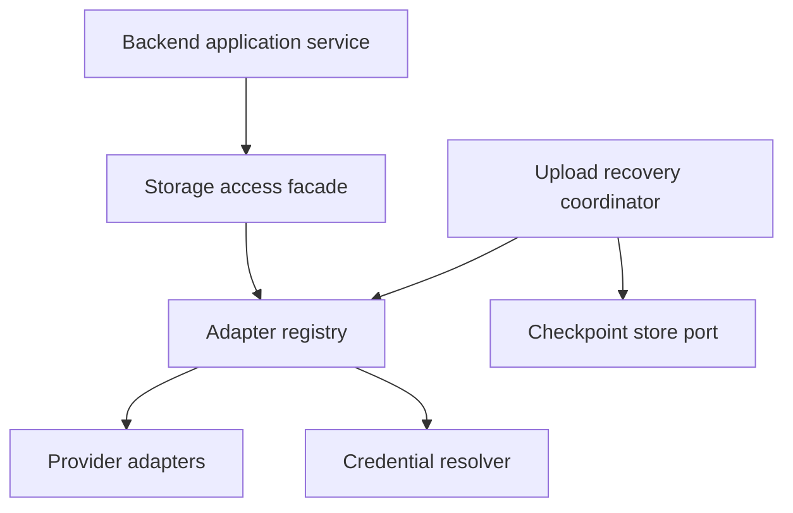

# Storage Access Abstraction

The storage layer provides provider-neutral access to individual resources. It owns adapter routing, capability enforcement, stream lifetime, normalized failures, and upload recovery coordination. [Account management](account-management.md) owns authentication and saved identities. Transfer scheduling, recursive traversal, synchronization, conflict policies, export, sharing, previews, and content encryption belong above the access layer.

Exact models and operations live in the [shared storage models](../src/shared/storage/models.ts), [adapter contract](../src/main/storage/ports/adapter.ts), [backend contracts](../src/main/storage/core/contracts.ts), and [access facade](../src/main/storage/access/storage-access.ts). Common contracts remain independent of Electron and provider SDK types.

## Ownership

The host supplies adapter factories, credentials, logging, and checkpoint persistence through [service ports](../src/main/storage/ports/services.ts). The registry owns connection creation and disposal. The [storage browser service](../src/main/services/storage/storage-browser.ts) composes backend access for the desktop UI; its renderer-facing API is defined separately in the [shared browser contract](../src/shared/storage-browser.ts).

## Native Resource Semantics

A provider identifies an adapter type. A connection identifies one configured account or endpoint. A space identifies an addressable root within that connection. Space discovery can be permission-limited; a usable explicitly configured root must not require permission to enumerate every root.

An entry reference combines a connection, space, and opaque adapter-owned locator. Preserve native IDs, keys, and paths. Names and display paths support navigation and presentation; they must not become universal keys or permanent identities. Renames and moves return the resulting entry/reference because path-based locators can change.

Google Drive permits duplicate names, so name lookup must preserve all candidates. Object-store keys require exact case and separators, and inferred prefixes remain distinct from objects. Only a local adapter applies OS path rules. Represent links explicitly and do not follow them automatically during traversal.

Missing metadata means unknown. Keep revisions separate from content checksums, preserve checksum algorithms, and do not infer a universal content hash from an ETag.

A connection ID is bound to its immutable configuration. Reconnecting with that configuration is allowed; assigning the same ID to a different account or endpoint is rejected.

## Capabilities and Operations

Capabilities describe effective operation support for an adapter, endpoint, space, entry type, and permissions, while space semantics describe native namespace traits such as duplicate-name allowance. Unknown support must remain explicit. Capability metadata guides callers, while execution still enforces authorization. Unsupported operations fail explicitly.

Listing returns pages with opaque cursors. Page size is a hint; enumeration does not promise a transactional or globally sorted snapshot. Facade cursors are bound to their instance, connection, parent, and request, and cannot serve as persistent recovery state.

Writes distinguish creation from replacement and require an explicit overwrite policy. Create-only must not overwrite a resource; providers that permit duplicate names can create distinct resources with the same name. Conditional replacement requires a native backend guarantee that also holds when publishing a resumed upload. A read-then-write check cannot provide that guarantee.

Native copy and move operate within a connection. Unsupported or cross-filesystem operations must not silently fall back to copy-then-delete. Recursive deletion and cross-connection operations require higher-level orchestration.

Removal follows provider semantics. Local file removal unlinks the selected file or link without following links; Google Drive removal moves the selected file to trash. Keep those choices in the [provider adapters](../src/main/storage/providers/); callers use the common operation and effective capability. UI confirmation and task presentation belong to the [task integration](task-queue.md).

## Streams and Cancellation

Byte streams and executable callbacks remain backend-only. Reads preserve backpressure, carry cancellation for the entire stream lifetime, and require disposal when abandoned. Unsupported ranges or revision preconditions fail explicitly.

A one-shot source cannot promise replay or recovery after reopening. A reopenable source supplies a descriptor and bounded range reads so retries and recovery can verify and access the required bytes. Callers remain responsible for keeping the source available.

The caller owns the lifetime of an in-memory write session, and the adapter owns its unfinished remote write. A resumed session verifies the source and reconciles remote progress before sending content again.

## Upload Recovery Guarantees

The [upload coordinator](../src/main/storage/uploads/upload-coordinator.ts) owns common recovery state. Adapter drivers own transport protocols and private checkpoint payloads. Different backends can use contiguous offsets, independent parts, and different publication semantics; a common chunk size or universal commit/rollback is not assumed.

Durable recovery requires the following guarantees:

1. Persist a versioned checkpoint after creating a session and before sending content. Bind it to the connection configuration, space, target, write policy, and source.
2. Checkpoint only backend-acknowledged progress. Bytes sent or processed do not establish durability. Await checkpoint persistence before continuing.
3. On resume, validate the connection and source, then reconcile authoritative backend state before replaying work. The caller supplies the reopenable source; storage recovery does not reconstruct transfer jobs.
4. Reject detected source changes. Weak metadata requires an explicit proof of unchanged bytes, such as a strong validator, snapshot, or verification callback.
5. Distinguish suspension from explicit discard. Cleanup must report pending work or expiry where deletion is unavailable, and must never delete a published file.
6. Reconcile a lost final response before retrying. Report an unknown outcome when completion cannot be established safely.

The checkpoint backing store must provide atomic durable replacement and protect confidential payloads. One coordinator owns a backing store at a time; the host supplies cross-process exclusion. Driver session URLs, credentials, and private checkpoints must stay out of public DTOs and logs. Recovery support must be advertised only when its driver and persistence binding can provide the promised guarantees.

## Failures and Process Boundaries

Use the [shared failure model](../src/shared/storage/errors.ts) for error codes and retry hints. Preserve distinctions such as permission denial versus absence, and safe retry versus retry after reconciliation. Global job retry policy belongs to the task layer.

Adapters receive backend authorization through the credential resolver. Storage access must not start interactive login automatically or expose SDK authorization objects in common contracts.

IPC exposes specific validated operations using serializable DTOs and safe failures. Validate both senders and input. Streams, credentials, SDK responses, private recovery state, and raw provider error bodies remain in the backend.
